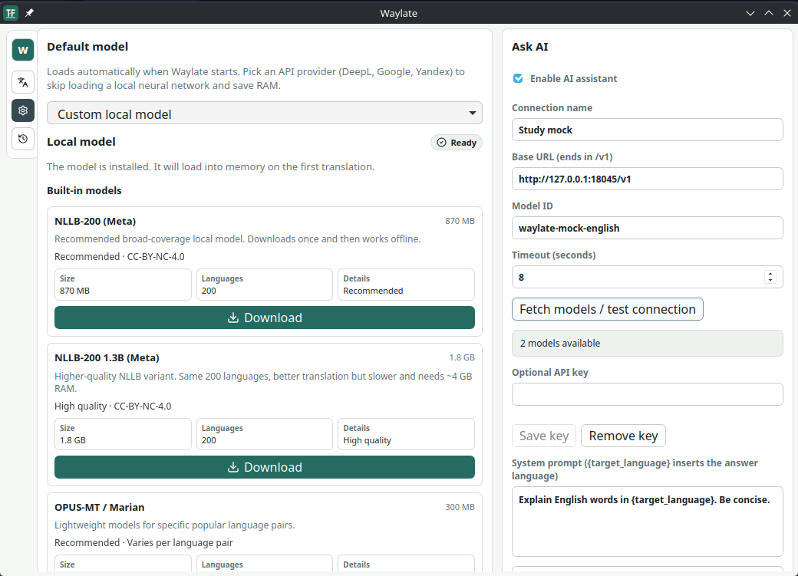
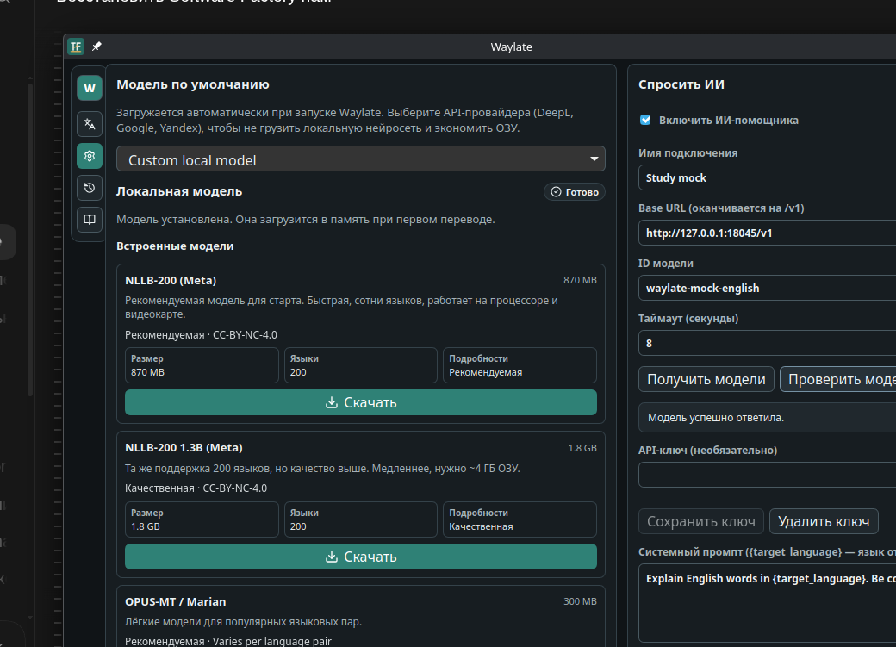

# Waylate

Waylate is a lightweight **translator and language-learning companion** for Arch Linux and KDE Plasma. Select text anywhere, press your KDE shortcut, and a translation popup opens. Optionally look up dictionary definitions, build your vocabulary, or ask an AI model about words and usage.

Use it right away with your own DeepL, Google Cloud Translate or Yandex Cloud
Translate API key — no downloads, no GPU, nothing to configure beyond pasting
a key. Prefer to keep translation fully offline? Waylate can also run a local
model (NLLB-200, or a GGUF model through llama.cpp) instead — no API key,
nothing leaves your machine.

## Install on Arch

Download the AppImage from [GitHub Releases](https://github.com/GolovIaroslav/waylate/releases), then run:

```bash
chmod +x Waylate-*-x86_64.AppImage
APPIMAGE_EXTRACT_AND_RUN=1 ./Waylate-*-x86_64.AppImage
```

From a checkout:

```bash
makepkg -si
```

For development:

```bash
npm install
npm run tauri dev
```

Useful runtime packages:

```bash
sudo pacman -S wl-clipboard webkit2gtk-4.1 libayatana-appindicator
```

Optional model tooling:

```bash
pipx install "huggingface_hub[cli]"
pipx inject huggingface-hub ctranslate2 transformers sentencepiece
```

## KDE Plasma Wayland Shortcut

Waylate does not pretend global shortcuts work everywhere on Wayland.
For v1, the reliable KDE path is a command shortcut:

1. Open System Settings.
2. Go to Keyboard > Shortcuts > Custom Shortcuts.
3. Add a command shortcut.
4. Use this command:

```bash
waylate translate-selection
```

When the selected text is not readable from the Wayland primary selection,
Waylate falls back to the clipboard and still lets you paste text manually in
the popup.

Other useful commands:

```bash
waylate
waylate translate-clipboard
waylate settings
```

## API Providers

The fastest way to get started: DeepL, Google Cloud Translate and Yandex Cloud
Translate are built in. Open Settings, turn on network providers, paste your
own key, and pick that provider as the default model — no download, no GPU.
Waylate stores API keys through the system Secret Service keyring and does not
write them into `config.json`.

Waylate does not ship shared API keys. Each user must add their own provider key.
Yandex also needs a Cloud Folder ID.

## Word Dictionary and Vocabulary

The optional **Word dictionary** feature is **off by default**. Enable it in
Settings > Privacy and APIs > **Enable word dictionary (online lookups)**.
When you translate a **single word**, Waylate preserves the normal translation
and additionally shows definitions by sense, example sentences, synonyms,
available translations and pronunciation text. A counter tells you whether you
have looked up that word previously; click **Add to vocabulary** to save it.
The **My vocabulary** icon in the sidebar appears only while this feature is
enabled. You can review and remove saved words or export them to JSON, CSV or
TSV in your Downloads directory. The UI is localized in English, Russian and
Slovak. Vocabulary and lookup counts are stored locally in SQLite independently
of the normal translation history, which can remain disabled.

The dictionary uses [FreeDictionaryAPI.com](https://freedictionaryapi.com/),
with content from [Wiktionary](https://www.wiktionary.org/) (CC BY-SA). No API
key, account or paid subscription is required. The dictionary lookup sends
**only the requested single word** to that service; a separate network
translation provider, if selected, has its own data handling and API key.
Dictionary availability and coverage depend on Wiktionary and the public
service's rate limits. Unsupported words and network errors leave the normal
translation usable. Offline translation remains possible with the dictionary
turned off; offline dictionary definitions are not currently supported.

## AI assistant (opt-in)

Waylate is a compact translation and language-learning companion. It keeps ordinary translation, dictionary explanations, and a private SQLite vocabulary alongside an **optional** AI question interface. **AI is disabled by default**, and it never answers or sends requests automatically.

In **Settings → Ask AI**, enable the assistant and enter an OpenAI-compatible **Base URL** (include the provider's documented API path), a model ID, and optionally an API key:

- **Local llama.cpp server:** `http://127.0.0.1:8080/v1` with the model ID your server exposes. No API key is needed when the local server does not enforce one. The server must already be running; Waylate does not start it.
- **Ollama Cloud via local Ollama:** If you have signed in to the Ollama app, use `http://127.0.0.1:11434/v1` and select a supported `:cloud` model. Requests are processed by Ollama Cloud, use your account's usage quota, and require authorization via Ollama; the loopback URL does not make this private local inference. [Official Ollama API documentation](https://docs.ollama.com/api/openai-compatibility).
- **Cloud provider:** the provider's documented **HTTPS** Base URL and an official API key. Set the model ID exactly as the provider requires. For example, OpenRouter uses `https://openrouter.ai/api/v1`, and Google AI Studio's OpenAI-compatible interface uses `https://generativelanguage.googleapis.com/v1beta/openai/` (with a Gemini API key, **not** Antigravity consumer OAuth). Provider-specific APIs may not implement this subset of the OpenAI interface.
- Click **Fetch models** to query `GET /models`, then choose a model from the dropdown (or select manual entry to provide a custom ID). This discovery step is optional: you can always enter the model ID manually if the endpoint does not implement model listing. A successful discovery is **not** proof that generation, model authorization, or billing will succeed. Click **Test model** to send one explicit short test question to `POST /v1/chat/completions`; this may incur provider charges.
- Reasoning effort can be left at **Provider default**, or requested as **Off / Minimal / Low / Medium / High / Extra high**. The app sends `reasoning_effort` only when you choose a level. Not all models support it; if the provider rejects the setting, switch to Provider default. If an API returns `reasoning_content`, `reasoning`, or a local `<think>` block, Waylate shows it separately in a collapsed section, never as the main answer. Truncated completions are flagged. Set a timeout (1–300 seconds; default 120). Adjust or reset the editable System Prompt. The `{target_language}` placeholder expands to the current target-language name when a question is sent.

Once enabled, open **Ask AI** below the translator. **The source text from the main translation field is always the AI reference text**. Leave the optional question empty and click **Explain text** for the initial explanation, or enter a specific question and click **Ask**. Follow up in the same field after the answer; Waylate sends the previous user/assistant turns with each follow-up. Switching source text, source/target language, API URL, or AI model opens that translation's independent conversation. Returning to the original text restores its conversation **within the current app session** (up to 20 recent text/model conversations, keeping six exchanges per conversation). These ephemeral AI conversations are not stored in SQLite or the translation history and are cleared on app exit. The editable System Prompt defaults to brief plain-text responses (normally 2-4 sentences, no Markdown). Upgrading from v0.1.8 updates the old built-in default only; customized prompts are never replaced. No AI request is sent automatically. Disabling the assistant hides it while keeping the API key and system prompt. New replies use the current target language.

**Privacy and costs:** keys use the system Secret Service/KWallet and are not stored in `config.json`; the app only exposes whether a key is present. Remote AI providers can receive and retain your text and charge per token, request, or subscription; verify their current pricing and data retention independently. Loopback HTTP is allowed for local servers only; remote URLs require HTTPS. Requests and responses are bounded, time-limited and not retried automatically. OpenAI-compatible endpoints vary: this release supports JSON `GET /v1/models` (where available) and non-streaming `POST /v1/chat/completions` returning `choices[0].message.content` as plain text. Image/tool calls, streaming, and provider-specific APIs are not supported.

**Third-party login restriction:** Google Antigravity's consumer account/OAuth may **not** be used through third-party proxies or applications under [Google Antigravity Terms](https://www.antigravity.google/terms) and [FAQ](https://www.antigravity.google/docs/faq/). Do not configure Waylate with such authentication. A local-looking proxy URL does not imply that inference runs locally or that its account usage is permitted. Use the provider's official API key and permitted endpoint instead.

### Screenshots

Real Waylate v0.1.8 GUI test with a **local mock API** (not an online subscription), in light and dark themes:




## Future Anki integration (not yet implemented)

A later opt-in AnkiConnect integration could send saved vocabulary to a locally running, minimized Anki Desktop instance at `http://127.0.0.1:8765` without showing another Anki window. Each note would store stable word ID, word, translation, definition, example, part of speech, source/target languages and tags. Query existing IDs before `addNote` to avoid duplicates. Do not launch Anki automatically; when unavailable, fall back to an Anki-importable TSV export. Desktop/Android study uses standard AnkiWeb synchronization, not immediate direct Android delivery. Existing JSON/CSV/TSV export remains supported.

## Local Models

Prefer nothing to leave your machine, or want to translate with no network at
all? Waylate can also run a local model instead of an API key.

- `Meta NLLB-200 CTranslate2`: use Settings > Local model > Download and
  configure NLLB. Waylate downloads the catalog model from Hugging Face and
  saves the CTranslate2 model/tokenizer paths automatically.
- `Tencent Hy-MT GGUF`: use a local OpenAI-compatible server, for example
  `llama.cpp` server on `http://127.0.0.1:8080/v1/chat/completions`.
- `Custom local model`: use your own endpoint or local setup.

For CTranslate2/NLLB, Waylate calls:

```bash
waylate-ct2-translate --model /path/to/ct2-model --tokenizer facebook/nllb-200-distilled-600M --source eng_Latn --target rus_Cyrl "Text"
```

The selected model controls the visible language list. NLLB profiles show NLLB
language codes; API and GGUF profiles show a smaller practical list.

## Local Files

Waylate follows XDG directories:

- Config: `~/.config/waylate/config.json`
- Data and models: `~/.local/share/waylate`
- History: `~/.local/share/waylate/history.sqlite3`
- Vocabulary and previous word lookups: `~/.local/share/waylate/vocabulary.sqlite3`

History and dictionary are both off by default; they can be enabled separately.

## Development

```bash
npm run check
cd src-tauri && cargo check
npm run tauri build
npm run install:local-release
```

Use `npm run install:local-release` when you want to refresh the runnable
`waylate` command in `~/.local/bin`. It rebuilds the bundled frontend through
the Tauri CLI, installs the release binary, and relaunches it. Plain
`cargo build --release` is not the reliable workflow for updating the user-run
desktop binary.

Project shape:

- Tauri 2 handles tray, CLI commands, Wayland clipboard calls, config and model backends.
- Svelte renders the popup/settings/history UI.
- `wl-paste --primary` reads the Wayland primary selection, with clipboard fallback.
- Global shortcut portals are not the v1 default because KDE command shortcuts are more predictable today.

Good GitHub topics for the repository: `wayland`, `kde`, `arch-linux`,
`tauri`, `svelte`, `translation`, `llm`, `nllb`, `ctranslate2`.

## Community

Issues and pull requests are open on GitHub. Use bug reports for broken Wayland,
clipboard, tray, or model behavior; use feature requests for new model providers
and UI improvements.
